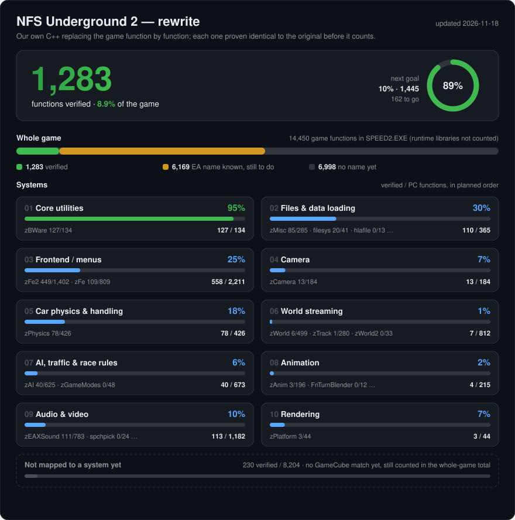

# Progress

_Generated by `tools/progress.py` on 2026-11-14 from `docs/symbols.csv`._

**49 of ~23,278 functions rewritten and verified (0.21%)**  
`▏░░░░░░░░░░░░░░░░░░░░`

A function counts as **verified** only when our C++ replaces the original inside the running game and the diff harness proves it identical: same results (floats bit-for-bit) and same register behaviour, on thousands of random and real inputs.

## Milestones

| | Milestone | Status |
|---|---|---|
| M0 | Game runs under Wine | ✅ done |
| M1 | Probe + MCP bridge | ✅ done |
| M2 | Unattended launcher | ✅ done |
| M3 | Input injection | ✅ done |
| M4 | Boot straight to free roam | ✅ done |
| M5 | Telemetry + scripted driving | ✅ done |
| M6 | Rewrite DLL + hot reload | ✅ done |
| M7 | Diff harness | ✅ done |
| M8 | System-by-system rewrite | 🟡 in progress |

## Systems

| System | Verified | Status |
|---|---:|---|
| Leaf utilities — Strings, maths, hashing, RNG | 42 | 🟡 started |
| File & chunk loading — Bundles, chunks, decompression | 7 | 🟡 started |
| Frontend / menus | 0 | ⬜ not started |
| Camera | 0 | ⬜ not started |
| Car physics / handling | 0 | ⬜ not started |
| World streaming | 0 | ⬜ not started |
| AI racers / traffic | 0 | ⬜ not started |
| Audio | 0 | ⬜ not started |
| Rendering — Last: the future port boundary | 0 | ⬜ not started |

## Done (verified)

### Chunks & JDLZ — 7

| Address | Function | Signature |
|---|---|---|
| `0x0043C100` | **FindChunkLoader** | `bChunkLoader* __cdecl(uint32_t id)` |
| `0x00570D70` | **LoadChunk** | `int __cdecl(bChunk*)` |
| `0x00570DD0` | **CopyChunksAligned** | `int __cdecl(int mode, bChunk* src, u32 size, u8* dst, int offset, int depth)` |
| `0x00570F00` | **ClearChunks** | `void __cdecl(bChunk* src, u32 size)` |
| `0x00573700` | **JdlzDecompress** | `uint32_t __cdecl(const uint8_t* src, uint8_t* dst)` |
| `0x00577AB0` | **LoadChunks** | `void __cdecl(bChunk* start, int size)` |
| `0x00577B10` | **UnloadChunks** | `void __cdecl(bChunk* start, int size)` |

### Maths (bMath) — 26

| Address | Function | Signature |
|---|---|---|
| `0x0043C140` | **bRandomSeeded** | `uint32_t __cdecl(uint32_t range, uint32_t* seed)` |
| `0x0043C1C0` | **bRandom** | `uint32_t __cdecl(uint32_t range)` |
| `0x0043C1F0` | **bRandomFloat** | `float __cdecl(float scale)` |
| `0x0043C240` | **bFMod** | `float __cdecl(float a, float b)` |
| `0x0043C280` | **bMod** | `int __cdecl(int a, int b)` |
| `0x0043C2B0` | **bSin** | `float __cdecl(uint16 angle)` |
| `0x0043C350` | **bSinRad** | `float __cdecl(float radians)` |
| `0x0043C370` | **bCos** | `float __cdecl(uint16 angle)` |
| `0x0043C390` | **bSinCos** | `void __cdecl(float* sin, float* cos, uint16 angle)` |
| `0x0043C490` | **bASin** | `uint32 __cdecl(float x) -> angle` |
| `0x0043C570` | **bATan2** | `uint32 __cdecl(float a, float b) -> angle` |
| `0x0043C780` | **bIdentity** | `Matrix4* __cdecl(Matrix4*)` |
| `0x0043C7C0` | **bInvertMatrix** | `bMatrix4* __cdecl(bMatrix4* out, const bMatrix4* in)` |
| `0x0043C9D0` | **bTransposeMatrix** | `bMatrix4* __cdecl(bMatrix4* out, const bMatrix4* in)` |
| `0x0043CE10` | **bDistBetween** | `float __cdecl(const bVector3*, const bVector3*)` |
| `0x0043CE50` | **bNormalize2** | `bVector2* __cdecl(bVector2* out, const bVector2* in)` |
| `0x0043CEB0` | **bNormalizeTo2** | `bVector2* __cdecl(bVector2* out, const bVector2* in, float len)` |
| `0x0043CF10` | **bNormalize** | `bVector3* __cdecl(bVector3* out, const bVector3* in)` |
| `0x0043CF90` | **bNormalizeTo** | `bVector3* __cdecl(bVector3* out, const bVector3* in, float len)` |
| `0x0043D090` | **bScaleAdd2** | `void __cdecl(bVector2* out, const bVector2* a, const bVector2* b, float s)` |
| `0x0043D0C0` | **bScaleAdd** | `bVector3* __cdecl(bVector3* out, const bVector3* a, const bVector3* b, float s)` |
| `0x0043D190` | **bEqualEps** | `int __cdecl(const bVector3*, const bVector3*, float eps)` |
| `0x0043D1E0` | **bCross** | `bVector3* __cdecl(bVector3* out, const bVector3* a, const bVector3* b)` |
| `0x0043D220` | **bInitBounds2** | `void __cdecl(bVector2* min, bVector2* max)` |
| `0x0043D410` | **bInBox2** | `int __cdecl(const bVector2* lo, const bVector2* hi, const bVector2* p, float margin)` |
| `0x00441000` | **bMulMatrix** | `bVector3* __cdecl(bVector3* out, const bMatrix4*, const bVector3*)` |

### Strings (bString) — 16

| Address | Function | Signature |
|---|---|---|
| `0x0043DB50` | **bStringHash** | `uint32_t __cdecl(const char*)` |
| `0x0043DB80` | **bStringHash2** | `uint32_t __cdecl(const char*, uint32_t prefix)` |
| `0x0043DBB0` | **bStrLen** | `int __cdecl(const char*)` |
| `0x0043DBD0` | **bStrCpy** | `char* __cdecl(char* dst, const char* src)` |
| `0x0043DC00` | **bStrNCpy** | `char* __cdecl(char* dst, const char* src, int n)` |
| `0x0043DC30` | **bStrCmp** | `int __cdecl(const char*, const char*)` |
| `0x0043DC60` | **bStrNCmp** | `int __cdecl(const char*, const char*, int n)` |
| `0x0043DCC0` | **bStrICmp** | `int __cdecl(const char*, const char*)` |
| `0x0043DD10` | **bStrNICmp** | `int __cdecl(const char*, const char*, int n)` |
| `0x0043DDA0` | **bStrCat** | `char* __cdecl(char* dst, const char* a, const char* b)` |
| `0x0043DDF0` | **bStrChr** | `const char* __cdecl(const char*, int c)` |
| `0x0043DE20` | **bStrUpr** | `char* __cdecl(char*)` |
| `0x0043DE50` | **bStrToInt** | `int __cdecl(const char*)` |
| `0x0043DFE0` | **bWStrLen** | `int __cdecl(const uint16_t*)` |
| `0x0043E000` | **bStrToWStr** | `uint16_t* __cdecl(uint16_t* dst, const char*)` |
| `0x0043E030` | **bStrNToWStr** | `uint16_t* __cdecl(uint16_t* dst, const char*, int n)` |

## Not done yet

Functions we have found and named but not rewritten yet (everything else in the exe is still unexplored).

| Address | Name | Notes |
|---|---|---|
| `0x0057EAD0` | UpdateFrameTime _(rewritten, not verified)_ | only caller 0x5812ED passes QPC delta; writes 0x865198 (not the sim step: halving it had no visible effect)… |
| `0x004022C0` | nullsub_4022C0 | empty (ret); stripped debug hook |
| `0x0043BD50` | bBreak | int3; ret (debug break left in release) |
| `0x0043BDF0` | bGetTicker | QueryPerformanceCounter-based tick |
| `0x0043C0B0` | bChunkLoader_ctor | registers into 0x828050 (static init only) |
| `0x0043C9C0` | bMulMatrix_thunk | jmp 0x441000 |
| `0x0043DEF0` | bStrToFloat | x87 math (needs exact-x87 approach); uses bStrToInt for the exponent |
| `0x004400D0` | bSPrintf | -> 0x43FBC0 (vsprintf) |
| `0x00577C70` | LoadChunksAligned? | measures with CopyChunksAligned; if realign needed: alloc (0x440820), copy, ClearChunks, load, unload, free… |
| `0x005B7EE0` | ResetControllerStates | called on WM_ACTIVATEAPP; resets per-device state blocks at 0x874C48/0x874FB8/0x875328 |
| `0x005C1840` | InputDevice_ReadKeyboard | Poll + buffered GetDeviceData; sets/clears bit uAppData of this+0x08 (u64 held actions); see docs/structs/i… |
| `0x005CCD60` | MainWndProc | registered by RegisterClassExA at 0x005D25E4; switch on msg; hooked by probe keep_active |
| `0x0075BED4` | _ftol2 | MSVC CRT float->int, 1120 callers |
| `0x0075D8E0` | _allshl | MSVC CRT 64-bit shift helper |
| `0x007A0A30` | str_TRACKS_BUN | .rdata string |
| `0x007EA624` | g_RandomSeed | bRandom seed (lead for repeatable traffic) |
| `0x007EA628` | g_ASinTable | bASin table |
| `0x007EACB0` | g_ATanTable | bATan2 table, indexed 0x7EACB0 - ftol(-256*ratio) |
| `0x00865198` | g_FrameTime | 1/60 at 60 fps; NOT the simulation step (see UpdateFrameTime) |
| `0x008665C0` | g_ChunkNameRing | debug names written by UnloadChunks; index at 0x866610 |
| `0x0086E5C0` | g_pKeyboardDevice | action-mapped keyboard device |
| `0x00870768` | g_TextEntryMode | keyboard events use dwOfs (typing) when set |
| `0x00870988` | g_AppActive | global: WM_ACTIVATEAPP wParam; WM_SIZE !IsIconic(hwnd) |
| `0x008709E0` | g_WndInactive | global: WM_ACTIVATE LOWORD(wParam)==WA_INACTIVE, gates calls on object at 0x0082B884 |
| `0x0089CE58` | g_AIRoster | player, 3 RaceCarControllers, 10 TrafficControllers; docs/structs/traffic.md |
