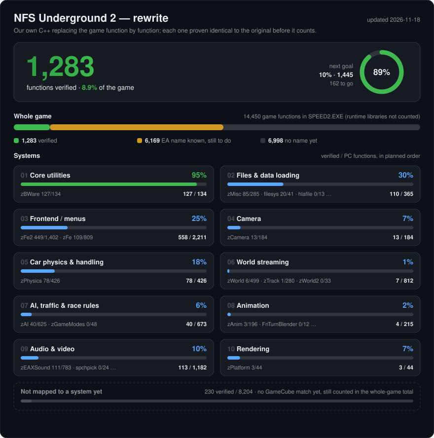

# nfsu2-rewrite

Rebuilding **Need for Speed: Underground 2** (PC, 2004, NA v1.2) as our own C++ code, one function at a time,
while the original game keeps running.

**→ Full lists of what's done and what isn't: [PROGRESS.md](PROGRESS.md)**

## How it works

- **A probe inside the game.** An ASI plugin loaded into the original `SPEED2.EXE` (under Wine) exposes the
  running game: memory, input, screenshots, car telemetry, frame-locked scripted driving.
- **The rewrite lives in its own DLL.** Each rewritten function is hooked in place of the original and can be
  switched between original and rewrite at runtime. Rebuilding the DLL hot-reloads it into the running game, so
  you can keep driving while functions are swapped underneath.
- **Nothing counts until it's proven identical.** A diff harness runs the original and our version side by side
  inside the game on thousands of random and real inputs: results must match (floats bit for bit) and so must the
  registers the game's optimised code relies on. Only then is a function marked **verified** and switched on.

The game files are not part of this repository; you need your own copy of NFSU2 (NA v1.2).

## Layout

| Folder | What's in it |
|---|---|
| `probe/` | the in-game probe: stable loader (`nfsu2_probe.asi`) + hot-reloadable core (`nfsu2_core.dll`) |
| `game/` | the rewrite (`nfsu2_game.dll`), one folder per system, each function with its diff test |
| `tools/` | launcher, MCP bridge, reverse-engineering helpers, the x87 → C++ lifter, `progress.py` |
| `tests/` | milestone checks and recorded drives |
| `docs/` | `DEVLOG.md` (day-by-day log), `symbols.csv` (every named function), `structs/` |

Update the tracker after a batch: `.venv/bin/python tools/progress.py`
